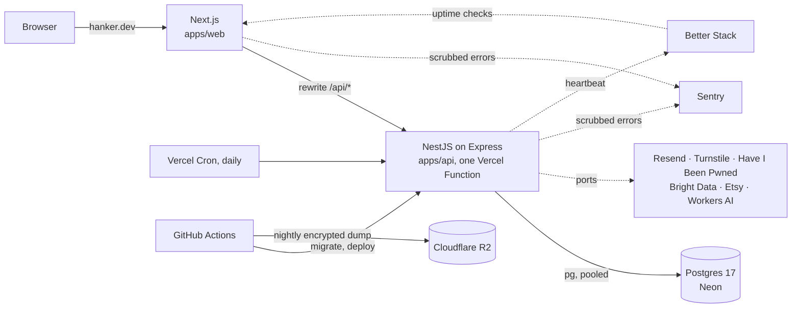

# Hanker

[](https://github.com/Shockolate/wishlist-app/actions/workflows/deploy.yml)
[](LICENSE)
[](https://incidents.betterstack.com/?utm_source=status_badge)
[](https://scorecard.dev/viewer/?uri=github.com/Shockolate/wishlist-app)

A wishlist app for family and friends, running at **https://hanker.dev**. You keep one list of things you'd love, then share a secret link. Anyone with the link can claim an item, so nobody buys the same gift twice, and you never see who is getting what.

<p align="center">
  
  
  
  
</p>

Sample data. The people and the list are made up.

## What it does

- **Owners** sign up, confirm their email, and build one list. They paste a shop link and, when the shop allows it, the title and price are filled in. Or they type an idea. They reorder items and rotate the share link whenever they like. They tag items so gifters can filter, and Hanker can suggest tags from the shop’s details, reusing the list’s own tags.
- **Gifters** open the link from a text message, with no account. They claim an item in a few taps, and come back to change or cancel the claim from any device.
- **Your gifts.** A gifter who is signed in with a confirmed email gets their claims on one page, across everyone’s lists, grouped by the person they’re for. They tick off what they’ve bought (only they see it), change a name or quantity, or let a claim go. A claim made signed out joins when its link is opened signed in. Claims that disappear leave a note for about 30 days.
- **Surprises stay safe.** An owner who hasn't opted in never receives claim data from the server. It isn't merely hidden in the UI. Owners who opt in see only how many are claimed, never by whom.

## How it's built

Two Vercel projects sit behind one origin, joined by a Next.js rewrite. The browser only ever talks to `hanker.dev`, so the session is a first-party `HttpOnly` cookie and there is no CORS. Everything else the API needs sits behind a port, an interface with a real adapter in production and a fake in tests.



| Service               | Used for                                                    | If it's down or unset                                     |
| --------------------- | ----------------------------------------------------------- | --------------------------------------------------------- |
| Vercel (Hobby)        | Both apps, and the daily cleanup cron                       | The site is down; roll back or wait                       |
| Neon (Free)           | Postgres, plus a separate project for preview databases     | Pages that read data fail; Live and Site monitors stay up |
| Resend                | Account email                                               | Sign-up and password reset can't send                     |
| Cloudflare Turnstile  | CAPTCHA on sign-up and email requests                       | Those requests answer `503`; everything else works        |
| Have I Been Pwned     | Breached-password check (k-anonymity: only a hash prefix)   | The check is skipped                                      |
| Bright Data, Etsy API | Title and price for Amazon and Etsy links                   | The owner types the details in                            |
| Workers AI            | Tag suggestions                                             | No suggestions; nothing else changes                      |
| Sentry                | Error reports, scrubbed of tokens and emails before sending | Errors go unreported; the app is unaffected               |
| Better Stack          | Uptime monitors and heartbeats, alerting by email           | Nobody is alerted                                         |
| Cloudflare R2         | Nightly `age`-encrypted backups, kept 30 days               | That night's backup fails, and its heartbeat raises it    |

| Path                 | What                                                                                                                                                                                                             |
| -------------------- | ---------------------------------------------------------------------------------------------------------------------------------------------------------------------------------------------------------------- |
| `apps/web`           | Next.js App Router, Tailwind, Radix, TanStack Query                                                                                                                                                              |
| `apps/api`           | NestJS 12, Drizzle ORM, SQL migrations. Email, CAPTCHA, breached-password checks, link metadata and shop lookups, tag suggestions, error reporting and the cron heartbeat sit behind ports, with fakes for tests |
| `packages/contracts` | Zod schemas and error codes for every request and response, the only code the two apps share                                                                                                                     |
| `e2e`                | Playwright golden paths, accessibility checks, and post-deploy smoke tests                                                                                                                                       |

TypeScript and ESM throughout, in a pnpm + Turborepo monorepo. It is designed to run on free tiers (hosting, database, email, CAPTCHA, error reporting, monitoring, backups, AI), so the only recurring cost is the domain.

## Decisions worth a look

Each of these has its rationale in the [design spec](docs/superpowers/specs/2026-10-07-wishlist-app-design.md), and most are pinned by tests.

- **Spoilers are enforced on the server.** Every read that returns claims goes through one pure function, [`projectWishlist`](apps/api/src/claims/projection.ts). For an owner who hasn't opted in, `remaining` and `claims` are absent from the JSON, and integration tests assert that they are absent, not empty.
- **Claims can't oversell.** A claim locks only its item's row (`SELECT … FOR UPDATE`), which keeps one lock order everywhere. A test fires 20 concurrent claims at the last unit against a real Postgres and expects exactly one `201` and nineteen `409`s. [Spec §6.3](docs/superpowers/specs/2026-10-07-wishlist-app-design.md#63-claim-concurrency).
- **Links are secrets.** Share and manage links grant access, so those pages send `Referrer-Policy: no-referrer` and `noindex`. Error reports run through [`redactTokens`](packages/contracts/src/redact.ts) before they leave the app. [Spec §6.7](docs/superpowers/specs/2026-10-07-wishlist-app-design.md#67-tokens-in-urls).
- **Link previews are hardened against SSRF.** The server resolves the host itself, accepts only public addresses from an allowlist, connects to the address it vetted, and re-checks every redirect. [`apps/api/src/unfurl`](apps/api/src/unfurl), [spec §6.8](docs/superpowers/specs/2026-10-07-wishlist-app-design.md#68-unfurl-ssrf).
- **CI has a trust model.** Jobs that build or test workspace code hold no secrets, and jobs that hold secrets run only pinned tools. A [policy test](scripts/workflow-policy.test.mjs), itself checked by [mutation tests](scripts/workflow-policy.mutations.test.mjs), fails the build if a later edit weakens that. [Design note](docs/superpowers/specs/2026-10-08-ci-secret-isolation-and-seeded-previews-design.md).
- **Someone has thought about the day it breaks.** See [Operations](#operations) below.
- **Dependencies are audited, including the ones GitHub can't see.** GitHub's dependency graph lists only direct packages, so CI runs `pnpm audit --prod` against the lockfile and fails on a high or critical advisory in anything that ships. The Scorecard badge above still counts open advisories. They are in dev and deploy tooling, almost all in the Vercel CLI, where a newer version doesn't clear them, and none of it is part of the running app.
- **Tag suggestions run on a free tier that neither keeps nor trains on the data.** Cloudflare Workers AI sits behind a port, and is sent only an item's title, note, the shop's web address and description, and the list's tag names, never the full link. Suggestions are optional help: a failure shows nothing, and a tag is added only when tapped. [Design](docs/superpowers/specs/2026-10-23-tag-suggestions-design.md).
- **Migrations are expand, then contract,** so each one works alongside the API version that is currently deployed. CI lints them with [squawk](https://squawkhq.com).

The work was planned and delivered in order: a spec, a [roadmap](docs/superpowers/plans/2026-10-07-roadmap.md), then one plan per slice, all in [`docs/superpowers`](docs/superpowers).

## Operations

Hanker is run by one person, in spare time, on free tiers. So the strategy is to make it cheap to keep running and hard to break quietly. The runbooks are in [docs/operations.md](docs/operations.md) and [docs/deployment.md](docs/deployment.md).

- **Nothing fails silently.** Three uptime monitors watch the site, the API and the database. The nightly backup and the daily cleanup each ping a heartbeat, so a job that stops running raises an alert, not just one that fails. Every credential with an expiry is in [a table](docs/operations.md#credentials) with its date, what it unlocks and how to rotate it.
- **Optional things degrade; they never break the rest.** Shop lookups, tag suggestions and error reporting sit behind ports. An unset key turns a feature off, and a failing service falls back: an Amazon link the lookup can't fill is typed in by hand. Only the database and email are load-bearing.
- **Recovery is rehearsed, not assumed.** Neon restores the last 6 hours to a point in time. Older than that, nightly dumps encrypted with `age` sit in R2 for 30 days. A restore drill decrypts a real dump into a throwaway Postgres and checks it, every quarter and after any change to the backup path. Rolling back code is Vercel's instant rollback, web before API.
- **Shipping is boring.** Every change is a small pull request in a stack, with its own preview on a database in a separate Neon project that never holds production data. Production deploys only `main`'s tip and refuses a stale commit. Migrations are expand, then contract, so a deploy never needs the database and the code to change at the same moment.
- **The pipeline is guarded like production.** Jobs holding deploy secrets run only lockfile-pinned tools. Renovate merges only dev-only tooling on its own; everything that ships waits for review. The [policy test](scripts/workflow-policy.test.mjs) fails the build if a later edit loosens any of this.
- **Free tiers are watched, not hoped for.** The database's uptime check runs every 30 minutes, not 3, so Neon still sleeps and stays inside its compute quota. Paid tiers stay off on purpose (Bright Data has no funds; Workers AI stays on the free allowance), so a spike can stop a feature but never send a bill. A monthly check covers each quota.
- **Privacy is an operational promise too.** Logs and error reports never carry passwords, tokens, raw email addresses or SQL parameters. Account deletion removes the account's data, and notes about gifts that disappeared are purged after 30 days by a job that is itself monitored.
- **Accepted risks are written down.** Where a fix isn't worth it yet, the risk, the reason and the trigger to revisit it live in [docs/deployment.md](docs/deployment.md#cicd-supply-chain-hardening). For example, one Vercel token serves both previews and production, until someone else gets write access.

## Testing

| Command                         | What runs                                                                | Docker |
| ------------------------------- | ------------------------------------------------------------------------ | ------ |
| `pnpm test`                     | Unit tests in every package (Vitest)                                     | No     |
| `pnpm test:integration`         | API endpoints against a throwaway Postgres (Testcontainers), no DB mocks | Yes    |
| `pnpm test:e2e`                 | Playwright against production builds, with mail through Mailpit          | Yes    |
| `pnpm turbo run lint typecheck` | ESLint and TypeScript                                                    | No     |

Behavior changes are written test-first. CI runs all of the above on every pull request, plus Prettier, `pnpm audit`, actionlint, a migration lint, the workflow policy and script tests, and a dependency review.

## Run it locally

You need Node 24 (`nvm use`), pnpm 12.14.0 (pinned by `packageManager`) and Docker.

```bash
pnpm install
cp apps/api/.env.example apps/api/.env
docker compose up -d --wait          # Postgres and Mailpit
pnpm --filter @wishlist/api db:migrate
pnpm dev                             # web on :3000, API on :3001
```

Sign-up emails land in Mailpit at http://localhost:8025. The rest, including the Playwright setup, is in [docs/development.md](docs/development.md).

## More

- [docs/development.md](docs/development.md): setup, tests, the database, refreshing the screenshots above
- [docs/deployment.md](docs/deployment.md): Vercel, Neon, environment variables, the cron
- [docs/operations.md](docs/operations.md): readiness checklist, recurring chores, where to start when something breaks
- [CONTRIBUTING.md](CONTRIBUTING.md): stacked pull requests and merge rules
- [SECURITY.md](SECURITY.md): how to report a vulnerability

Built with [Claude Code](https://claude.com/claude-code) as a pairing tool. [AGENTS.md](AGENTS.md) is the contract it works under, and every change still lands through a pull request and CI.

## License

[MIT](LICENSE)
