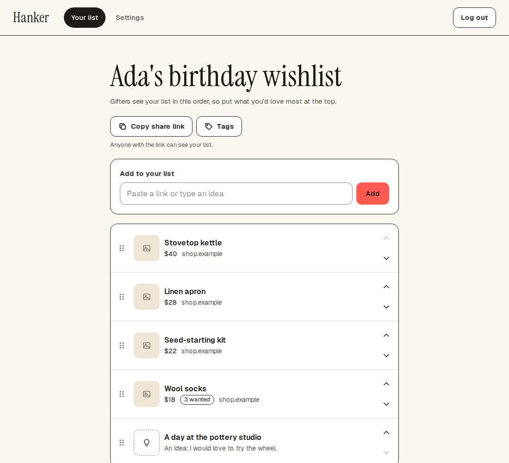
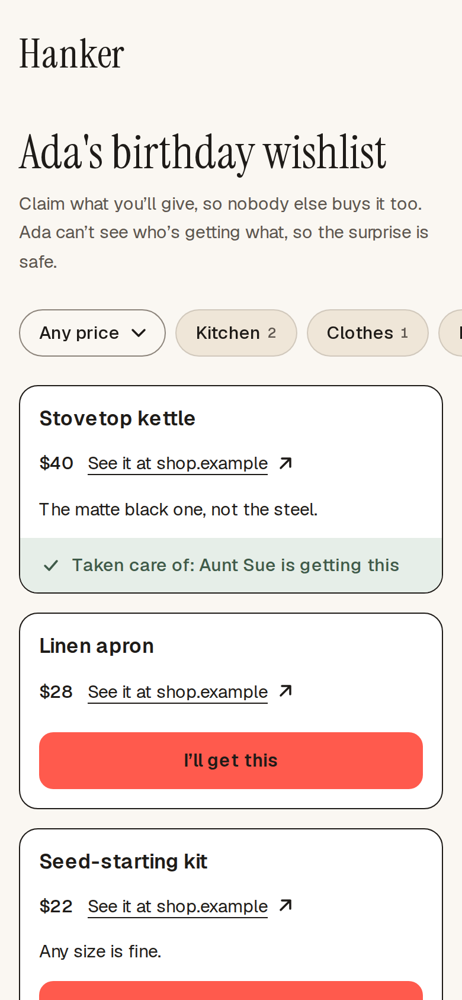
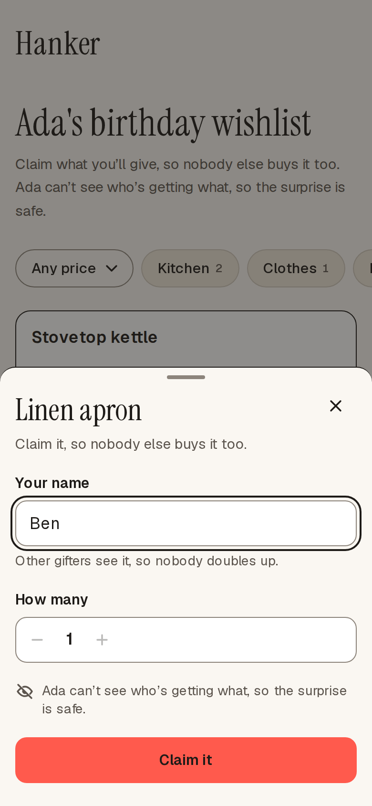
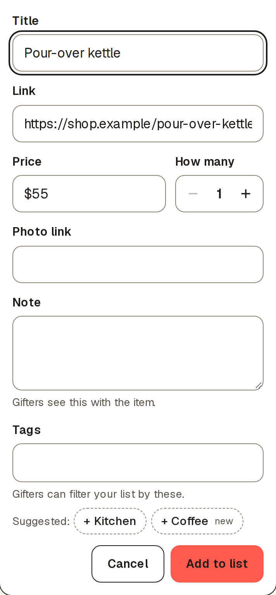
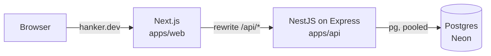

# Hanker

[](https://github.com/Shockolate/wishlist-app/actions/workflows/deploy.yml)
[](LICENSE)
[](https://incidents.betterstack.com/?utm_source=status_badge)
[](https://scorecard.dev/viewer/?uri=github.com/Shockolate/wishlist-app)

A wishlist app for family and friends, running at **https://hanker.dev**. You keep one list of things you'd love, then share a secret link. Anyone with the link can claim an item, so nobody buys the same gift twice, and you never see who is getting what.

<p align="center">
  
  
  
  
</p>

Sample data. The people and the list are made up.

## What it does

- **Owners** sign up, confirm their email, and build one list. They paste a shop link and, when the shop allows it, the title and price are filled in. Or they type an idea. They reorder items and rotate the share link whenever they like. They tag items so gifters can filter, and Hanker can suggest tags from the shop’s details, reusing the list’s own tags.
- **Gifters** open the link from a text message, with no account. They claim an item in a few taps, and come back to change or cancel the claim from any device.
- **Surprises stay safe.** An owner who hasn't opted in never receives claim data from the server. It isn't merely hidden in the UI.

## How it's built

Two Vercel projects sit behind one origin, joined by a Next.js rewrite. The browser only ever talks to `hanker.dev`, so the session is a first-party `HttpOnly` cookie and there is no CORS.



| Path                 | What                                                                                                                                      |
| -------------------- | ----------------------------------------------------------------------------------------------------------------------------------------- |
| `apps/web`           | Next.js App Router, Tailwind, Radix, TanStack Query                                                                                       |
| `apps/api`           | NestJS 12, Drizzle ORM, SQL migrations. Email, CAPTCHA, breached-password checks and link metadata sit behind ports, with fakes for tests |
| `packages/contracts` | Zod schemas and error codes for every request and response, the only code the two apps share                                              |
| `e2e`                | Playwright golden paths, accessibility checks, and post-deploy smoke tests                                                                |

TypeScript and ESM throughout, in a pnpm + Turborepo monorepo. It is designed to run on free tiers (hosting, database, email, CAPTCHA, error reporting), so the only recurring cost is the domain.

## Decisions worth a look

Each of these has its rationale in the [design spec](docs/superpowers/specs/2026-10-07-wishlist-app-design.md), and most are pinned by tests.

- **Spoilers are enforced on the server.** Every read that returns claims goes through one pure function, [`projectWishlist`](apps/api/src/claims/projection.ts). For an owner who hasn't opted in, `remaining` and `claims` are absent from the JSON, and integration tests assert that they are absent, not empty.
- **Claims can't oversell.** A claim locks only its item's row (`SELECT … FOR UPDATE`), which keeps one lock order everywhere. A test fires 20 concurrent claims at the last unit against a real Postgres and expects exactly one `201` and nineteen `409`s. [Spec §6.3](docs/superpowers/specs/2026-10-07-wishlist-app-design.md#63-claim-concurrency).
- **Links are secrets.** Share and manage links grant access, so those pages send `Referrer-Policy: no-referrer` and `noindex`. Error reports run through [`redactTokens`](packages/contracts/src/redact.ts) before they leave the app. [Spec §6.7](docs/superpowers/specs/2026-10-07-wishlist-app-design.md#67-tokens-in-urls).
- **Link previews are hardened against SSRF.** The server resolves the host itself, accepts only public addresses from an allowlist, connects to the address it vetted, and re-checks every redirect. [`apps/api/src/unfurl`](apps/api/src/unfurl), [spec §6.8](docs/superpowers/specs/2026-10-07-wishlist-app-design.md#68-unfurl-ssrf).
- **CI has a trust model.** Jobs that build or test workspace code hold no secrets, and jobs that hold secrets run only pinned tools. A [policy test](scripts/workflow-policy.test.mjs), itself checked by [mutation tests](scripts/workflow-policy.mutations.test.mjs), fails the build if a later edit weakens that. [Design note](docs/superpowers/specs/2026-10-08-ci-secret-isolation-and-seeded-previews-design.md).
- **Someone has thought about the day it breaks.** Nightly encrypted backups go to object storage, and a restore drill proves they can be restored. Uptime monitors, error reporting and runbooks are in [docs/operations.md](docs/operations.md).
- **Dependencies are audited, including the ones GitHub can't see.** GitHub's dependency graph lists only direct packages, so CI runs `pnpm audit --prod` against the lockfile and fails on a high or critical advisory in anything that ships. The Scorecard badge above still counts open advisories. They are in dev and deploy tooling, almost all in the Vercel CLI, where a newer version doesn't clear them, and none of it is part of the running app.
- **Tag suggestions run on a free tier that neither keeps nor trains on the data.** Cloudflare Workers AI sits behind a port, and is sent only an item's title, note, shop details and the list's tag names, never a link. Suggestions are optional help: a failure shows nothing, and a tag is added only when tapped. [Design](docs/superpowers/specs/2026-10-23-tag-suggestions-design.md).
- **Migrations are expand, then contract,** so each one works alongside the API version that is currently deployed. CI lints them with [squawk](https://squawkhq.com).

The work was planned and delivered in order: a spec, a [roadmap](docs/superpowers/plans/2026-10-07-roadmap.md), then one plan per slice, all in [`docs/superpowers`](docs/superpowers).

## Testing

| Command                         | What runs                                                                | Docker |
| ------------------------------- | ------------------------------------------------------------------------ | ------ |
| `pnpm test`                     | Unit tests in every package (Vitest)                                     | No     |
| `pnpm test:integration`         | API endpoints against a throwaway Postgres (Testcontainers), no DB mocks | Yes    |
| `pnpm test:e2e`                 | Playwright against production builds, with mail through Mailpit          | Yes    |
| `pnpm turbo run lint typecheck` | ESLint and TypeScript                                                    | No     |

Behavior changes are written test-first. CI runs all of the above on every pull request, plus Prettier, actionlint and a migration lint, and a dependency review.

## Run it locally

You need Node 24 (`nvm use`), pnpm 12.10.1 and Docker.

```bash
pnpm install
cp apps/api/.env.example apps/api/.env
docker compose up -d --wait          # Postgres and Mailpit
pnpm --filter @wishlist/api db:migrate
pnpm dev                             # web on :3000, API on :3001
```

Sign-up emails land in Mailpit at http://localhost:8025. The rest, including the Playwright setup, is in [docs/development.md](docs/development.md).

## More

- [docs/development.md](docs/development.md): setup, tests, the database, refreshing the screenshots above
- [docs/deployment.md](docs/deployment.md): Vercel, Neon, environment variables, the cron
- [docs/operations.md](docs/operations.md): readiness checklist, recurring chores, where to start when something breaks
- [CONTRIBUTING.md](CONTRIBUTING.md): stacked pull requests and merge rules
- [SECURITY.md](SECURITY.md): how to report a vulnerability

Built with [Claude Code](https://claude.com/claude-code) as a pairing tool. [AGENTS.md](AGENTS.md) is the contract it works under, and every change still lands through a pull request and CI.

## License

[MIT](LICENSE)
